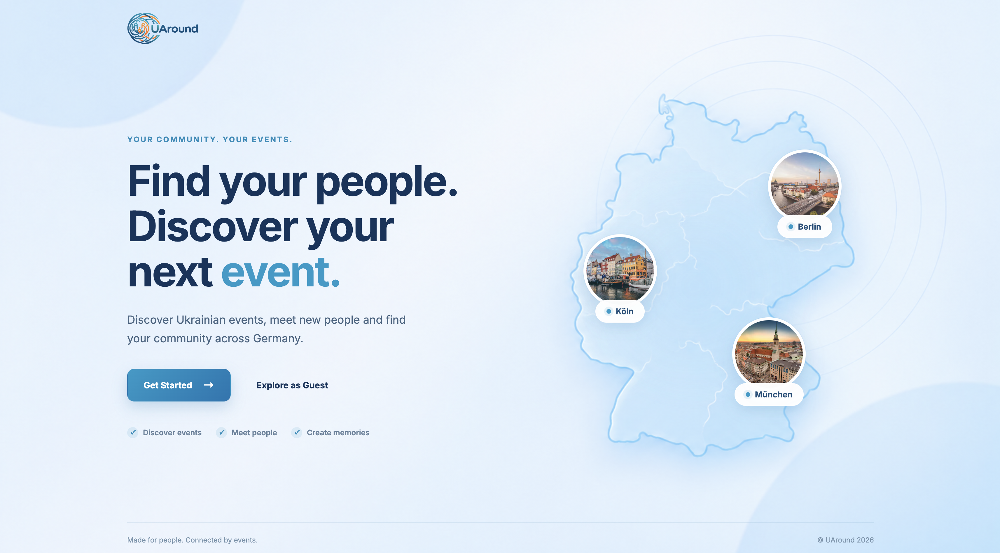
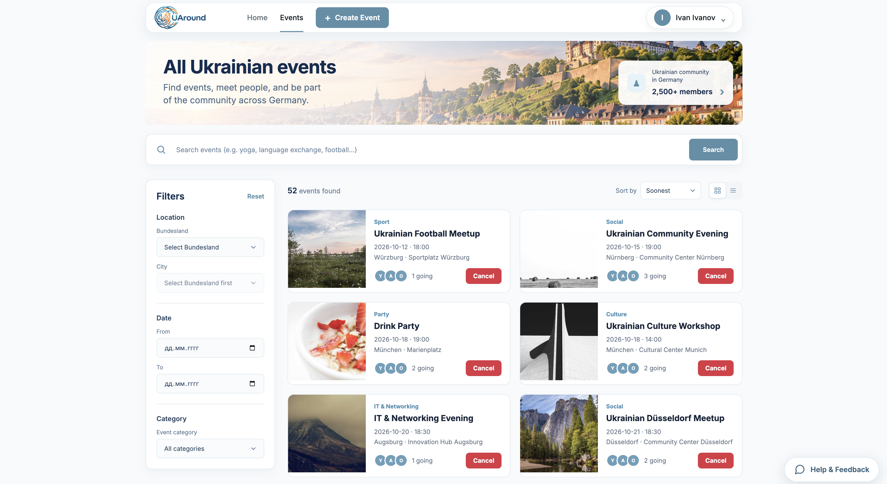
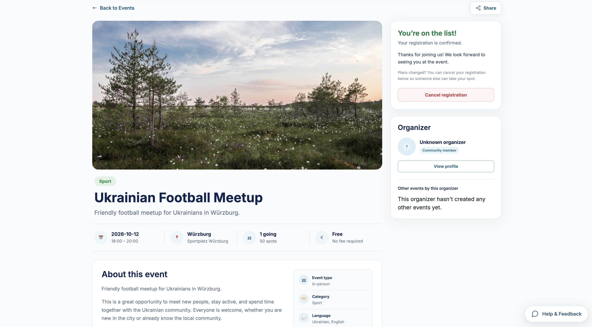
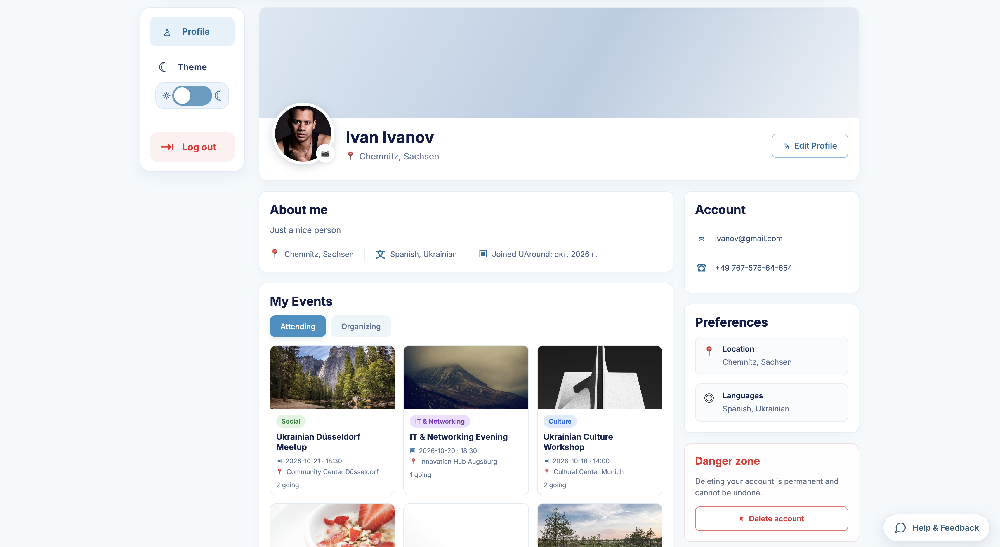

# UAround

🌐 **Live Demo:** [uaround.vercel.app](https://uaround.vercel.app)

### Discover events. Meet people. Feel connected.

**UAround** is a community events platform designed for Ukrainians living in Germany. It helps people discover local activities, join events, and organize meetups based on shared interests.

The goal is to make it easier to find your community and stay connected through real-life experiences.

---

## About the Project

Moving to a new country can make it difficult to discover local communities and meet people with similar interests.

UAround brings community events together in one place — from sports and music to social meetups, education, and cultural activities.

Users can explore events, register for activities, create their own events, and manage their profiles.

## Features

- **Event Discovery** — Browse events and explore activities by category.
- **Event Details** — View event descriptions, locations, capacity, and participants.
- **Event Creation** — Create and manage community events.
- **Event Registration** — Join events and track available places.
- **User Authentication** — Register, log in, and manage your account.
- **User Profiles** — Edit personal information and upload profile pictures.
- **Responsive Design** — Optimized layouts for desktop, tablet, and mobile devices.
- **Theme Support** — Light and dark interface themes.

## Screenshots

<p align="center">
  
</p>

<h3 align="center">Events Discovery</h3>

<p align="center">
  
</p>

<h3 align="center">Event Details</h3>

<p align="center">
  
</p>

<h3 align="center">User Profile</h3>

<p align="center">
  
</p>

## Tech Stack

### Frontend
- React
- TypeScript
- Vite
- SCSS

### Backend
- Node.js
- Express
- TypeScript
- REST API

### Database
- PostgreSQL
- Prisma ORM

### Tools
- Git
- ESLint
- npm

## Project Structure

```text
uaround/
├── backend/
│   ├── prisma/
│   └── src/
├── frontend/
│   ├── public/
│   └── src/
│       ├── api/
│       ├── components/
│       ├── context/
│       ├── pages/
│       ├── styles/
│       └── types/
└── README.md
```

## Getting Started

### Prerequisites

- Node.js
- npm
- PostgreSQL

### Installation

Clone the repository:

```bash
git clone https://github.com/myehor/uaround.git
cd uaround
```

Install frontend dependencies:

```bash
cd frontend
npm install
```

Install backend dependencies:

```bash
cd ../backend
npm install
```

Configure the environment variables and database connection before running the application.

## Project Goals

This project focuses on building a full-stack application and gaining practical experience with:

- Frontend architecture and reusable components.
- Type-safe development with TypeScript.
- REST API design and integration.
- Database modeling and ORM usage.
- Authentication and user management.
- Responsive UI development.

## Author

**Yehor Mishchenko**

[GitHub Profile](https://github.com/myehor)
